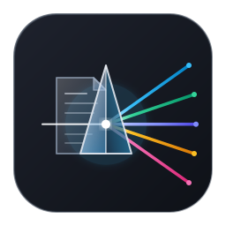
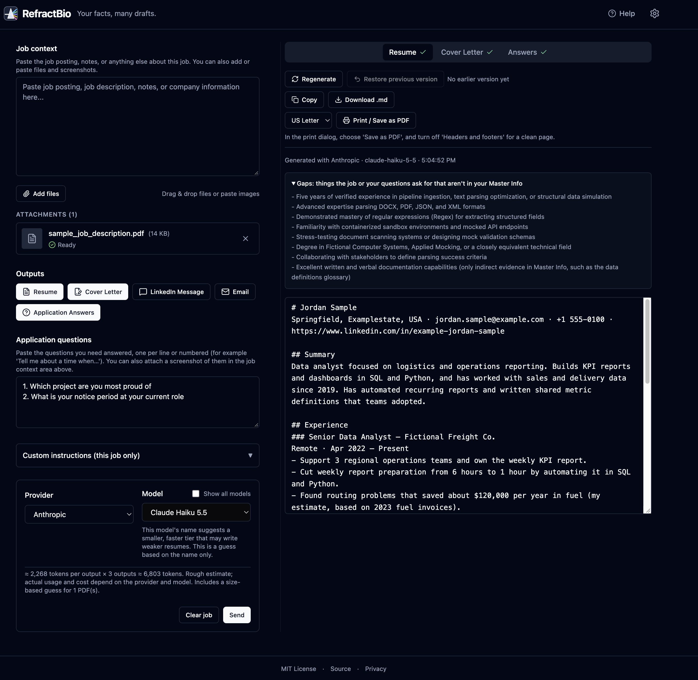

# RefractBio

[](https://github.com/revanth7667/RefractBio/actions/workflows/ci.yml)
[](https://github.com/revanth7667/RefractBio/actions/workflows/deploy.yml)

**Live site: https://refractbio.revanth7667.com/**

RefractBio is a client-side web application (Vite + React + TypeScript, zero backend) that helps you draft tailored resumes, cover letters, LinkedIn outreach messages, emails, and application answers from a single free-form Master Info file, using your own API key for Anthropic or Google Gemini. It operates exclusively in your browser: prompts are assembled deterministically from your facts, gaps are noted whenever a posting asks for background your Master Info does not verify, and no details are ever invented.



## Privacy

RefractBio has no backend servers, no analytics, no user accounts, no tracking cookies, and no third-party telemetry scripts. Network requests travel directly from your browser to your chosen AI provider endpoint over HTTPS, with credentials omitted and referrers stripped. Under Google's [Gemini API Additional Terms of Service](https://ai.google.dev/gemini-api/terms) (checked 2026-11-02), prompts, inputs, and generated content on the free/unpaid tier may be reviewed by human reviewers and used to improve Google products and AI models. Paid tiers (billing enabled) do not use your data for model training. Because resumes contain sensitive personal details, consider using a Paid Tier key or Anthropic.

## Quick Start

You can run RefractBio in two ways:
- **Hosted Web App**: Visit https://refractbio.revanth7667.com/ in any modern browser.
- **Single-File Download**: Download the standalone HTML file from [Releases](https://github.com/revanth7667/RefractBio/releases) and open it directly in your browser. Each release also includes a `.sha256` checksum file.

1. Open **Settings** and add your career details to the Master Info editor, or use the shipped sample as a starting point.
2. Add your job context (paste a job description, notes, or attach screenshots and documents).
3. Choose the outputs you want and click **Send** (or press `Ctrl+Enter` / `Cmd+Enter`).

## Getting an API Key

RefractBio uses a Bring-Your-Own-Key model. You need an API key from at least one supported provider:
- **Anthropic**: Create an API key in the [Anthropic Console](https://console.anthropic.com/settings/keys).
- **Google Gemini**: Create an API key in [Google AI Studio](https://aistudio.google.com/app/apikey).

Set spending limits in your provider's dashboard to keep total control over costs. RefractBio sends your API key in standard HTTP request headers (`x-api-key` for Anthropic, `x-goog-api-key` for Google Gemini); keys are never appended to URL query parameters or exposed in browser history. Keys remain in memory by default and are never persisted to disk unless you turn on "Remember my API keys on this device".

## Writing Your Master Info

Your Master Info is a single, free-form text file that acts as the single source of truth about your career history:
- **Defensible numbers**: State numbers, dates, and metrics truthfully. Keep estimates marked with "about" or "~"; the drafting prompt respects approximate wording.
- **"Not me" / Gaps section**: Include a section listing skills, technologies, or titles you do not have or do not want to claim. The model is strictly instructed never to claim anything listed in this section.
- **Stories and examples**: Include concise real-world stories (situation, action, outcome) for past roles and projects.
- **Backups**: Master Info is saved in this browser's local storage. Private browsing windows and profiles that clear site data on quit will erase local storage. Use the **Download** button in the Master Info editor to keep regular local backups on your computer.

## Application Answers and Printing to PDF

- **Application Answers**: Use the Questions box to paste form questions (or attach a screenshot of the application form). The model answers each question using only stories and facts from your Master Info; any missing information produces a line starting with `Needs your input:` and is listed in the Gaps note.
- **Printing to PDF**: The Resume and Cover Letter outputs include a built-in Print / Save as PDF button. In the browser print dialog, choose 'Save as PDF', turn off 'Headers and footers'; Chrome and Firefox use the app's paper size, Safari uses the print dialog's paper size; margins are 1.9 cm (0.75 in) in all of them.

## Hosted Version Notes

The hosted copy is a set of static files served by GitHub Pages on its own address (a dedicated subdomain), so the data it saves in your browser is kept separate from other websites. GitHub Pages cannot send some security headers, so the app relies on a Content Security Policy built into the page itself. The one protection that needs a header, stopping other websites from showing the app inside a frame, is not applied on this host.

## Single-File Version Caveats

RefractBio can be packaged as a standalone, self-contained single HTML file:
- **Storage restrictions**: If you use the downloaded single-file version, keep a downloaded copy of your Master Info. Some browsers may share or not keep saved data for files opened from disk. When opened directly from disk via the `file://` protocol, some browsers restrict access to persistent `localStorage`. If persistent storage is unavailable, an alert banner is shown; you can still draft documents, but your Master Info and settings will not persist across browser reloads.
- **Content Security Policy**: The single-file build requires inline scripts allowed because the code is inlined; the hosted build uses script-src 'self'.

## Development

Prerequisites: Node.js (version specified in `.nvmrc`). Note that the local development server runs without a Content Security Policy (CSP).

```bash
# Install dependencies
npm ci

# Start development server
npm run dev

# Run unit tests
npm test

# Run end-to-end tests
npm run e2e

# Build production assets
npm run build

# Build single-file bundle
npm run build:single
```

## Project Structure

For detailed architecture, state management, and file layout documentation, see [SPEC.md §7](SPEC.md#7-project-file-tree).

## Contributing

See [CONTRIBUTING.md](CONTRIBUTING.md) for contribution guidelines, testing practices, and verifying subpath deployments. To add a new provider, see [SPEC.md §13.6](SPEC.md#136-adding-a-provider-later-phase-2-not-in-the-mvp).

## License

- **License**: MIT License. See [LICENSE](LICENSE) for details.
- **Source Code**: [GitHub Repository](https://github.com/revanth7667/RefractBio)